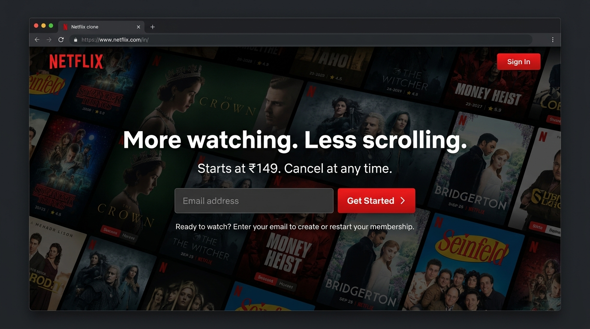
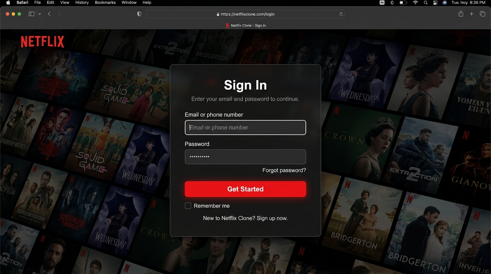
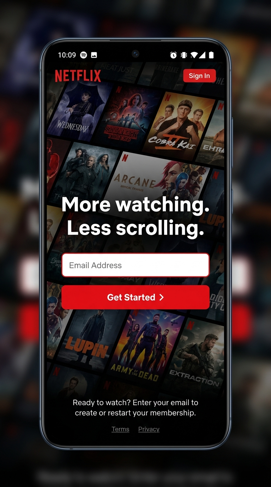

# 🎬 Netflix Clone

A responsive Netflix India landing page clone built with **HTML, CSS, and vanilla JavaScript** — no frameworks or dependencies.



---

## ✨ Features

- 🏠 **Landing Page** — Hero section with background image, CTA form, trending carousel, feature cards, FAQ accordion, and footer
- 🔐 **Sign-In Page** — Dedicated login page with email & password fields inside a styled card
- 📱 **Fully Responsive** — Looks great on desktop (1440px+), tablet (768px), and mobile (480px)
- 🎨 **Netflix-accurate UI** — Dark theme, signature red (#E50914) accent, hover effects, smooth transitions
- 📋 **FAQ Accordion** — Expandable questions using native `<details>` / `<summary>` elements (no JS needed)
- 🎞️ **Trending Carousel** — Horizontally scrollable movie poster row with hover zoom effect
- ⭐ **My List** — Save and remove titles, filter the carousel, and keep selections in `localStorage`
- 🎮 **Interactive Controls** — Carousel navigation, password visibility toggle, and accessible button states
- ✉️ **Form Feedback** — Browser email validation and clear demo-only submit messages

---

## 📸 Screenshots

### 🖥️ Homepage — Desktop


### 🔐 Sign-In Page


### 📱 Mobile Responsive View
<p align="center">
  
</p>

---

## 🛠️ Tech Stack

| Technology | Usage |
|------------|-------|
| **HTML5** | Page structure & semantics |
| **CSS3** | Styling, Flexbox, Grid, Media Queries |
| **JavaScript** | Carousel controls, persistent watchlist, and form interactions |

> No frameworks or dependencies. Forms provide front-end demo feedback only; no account or authentication backend is connected.

---

## 📂 Project Structure

```
Netflix_Clone/
├── index.html              # Main landing page
├── signin.html             # Sign-in page
├── js/
│   └── app.js               # Carousel, My List, and form interactions
├── README.md
├── screenshots/            # README images
│   ├── homepage-desktop.jpg
│   ├── signin-desktop.jpg
│   └── homepage-mobile.jpg
└── css/
    ├── style.css           # All styles + responsive media queries
    └── img/                # Images & assets
        ├── logo.svg
        ├── bg.jpg
        ├── t1.jpg
        ├── t2.jpeg
        ├── t3.jpeg
        ├── t4.jpg
        ├── t6.jpg
        ├── images.jpeg
        └── images-2.jpeg
```

---

## 🚀 Getting Started

1. **Clone the repository**
   ```bash
   git clone https://github.com/your-username/Netflix_Clone.git
   ```

2. **Open in browser**
   ```bash
   cd Netflix_Clone
   open index.html        # macOS
   # or just double-click index.html
   ```

That's it! No build tools, no npm install, no server needed.

---

## 📐 Responsive Breakpoints

| Breakpoint | Target |
|------------|--------|
| `> 768px` | Desktop — full layout |
| `≤ 768px` | Tablet — stacked cards, smaller images |
| `≤ 480px` | Mobile — compact text, single-column footer |

---

## 🎯 Sections Breakdown

| Section | Description |
|---------|-------------|
| **Navbar** | Netflix logo, language selector, Sign In button |
| **Hero** | Background image overlay, headline, subtitle, email + CTA form |
| **Trending Now** | Horizontally scrollable movie poster carousel |
| **More Reasons to Join** | 4 feature cards in a flex grid |
| **FAQ** | 6 expandable accordion items (pure CSS/HTML) |
| **Bottom CTA** | Repeated email signup form |
| **Footer** | 4-column link grid with support number |

---

## 📝 License

This project is for **educational purposes only**. All Netflix branding, logos, and content belong to Netflix, Inc.

---

## 🙌 Author

Made with ❤️ by **Saurav Rauthan**

⭐ If you liked this project, give it a star on GitHub!